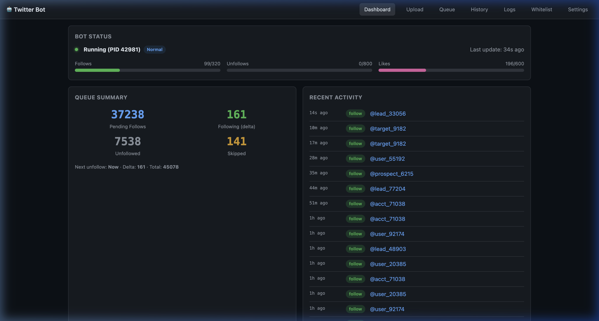

# Twitter Bot Dashboard (:8003)

Web dashboard to monitor and control the automated Twitter follow/unfollow bot. Also hosts the Server Portal on :8001.

## Screenshots

### Dashboard Overview
Real-time bot status, queue summary, follow/unfollow progress bars, and recent activity feed.



## How It Works

- `dashboard.py` — Flask web dashboard showing bot status, queue stats, follow/unfollow progress, and controls
- `twitter_bot.py` — Selenium-based bot that automates follow/unfollow actions using Chrome
- `portal.py` — The Server Portal (service directory), also runs from this directory on :8001
- Bot state tracked in `queue.json`, CSV logs, and `history.jsonl`
- Dashboard can start/stop the bot, trigger immediate actions, view logs

### When the bot unfollows

In both modes, anyone followed at least `unfollow_after_days` ago (the dashboard's
"Unfollow After (days)", re-read every cycle) is unfollowed, oldest first, unless they
follow back or are whitelisted. Normally that is one unfollow and one follow per cycle, even
when a busy follow day makes many come due at once. Only a backlog (more than one follow
still not unfollowed 24 hours after it came due, `BACKLOG_AFTER_OVERDUE_HOURS`: the bot was
stopped, or unfollows failed or were rate-limited while follows went on) slows following, to
once per 6 unfollows (`CATCH_UP_UNFOLLOWS_PER_FOLLOW`), so it clears in hours rather than
days without stopping growth; after that it is one of each per cycle again. The following difference
only caps following (it stops at 455); it no longer decides whether to unfollow. It used
to: Normal mode unfollowed only above 430, so after an Unfollow Only run it sat on overdue
follows for days.

Tests: `python3 test_unfollow_schedule.py` (drives the real loop with X stubbed out; needs
pandas + selenium, so run it on the bot host).

### Following a list again ("↻ Follow again")

A list is worked in two passes: everyone is followed, then — a few days later, per
`unfollow_after_days` — everyone is unfollowed. Unfollowing is the last thing the bot does
to a list, so as soon as it finishes the list's row offers **↻ Follow again**, with no
waiting period. It puts those handles back to `pending_follow` and drops them from
`followed.csv` / `unfollowed.csv` (the bot filters every new follow against both), so the
list starts over as if it had never been imported.

A finished list that still owes unfollows says `↻ after 12 more unfollows` instead of
offering the button. A list still visibly mid-follow shows nothing.

Two groups are deliberately left behind:

- **Mutuals** — anyone the unfollow pass found with "Follows you" on their profile. The
  bot flags the queue row `follows_back` and keeps following them, so a reset never
  re-follows someone we never stopped following.
- **Held** — handles still recorded as followed, here or in another list, including rows
  marked `followed` that already sit in `unfollowed.csv` (a pre-flag mutual, or a cleanup
  pass that unfollowed without updating the queue — the data can't tell which).

A reset can run with the bot up. That only holds because of two invariants, so don't
undo either of them:

- `queue.json` writes go through `queue_store.queue_transaction`, which reads and writes
  inside the same `data.lock` the dashboard takes.
- follows are **appended** to `followed.csv` (`record_followed`), never written back from
  the in-memory dataframe. The bot holds that frame for a whole cycle, so rewriting it
  would restore every row a reset just deleted, and the re-queued handles would be
  skipped forever as "already followed" — the reset would silently do nothing. This
  happened once in production, on 2026-09-18, before the append was in place.

The bot keeps its own copy of both CSVs for the rest of the current cycle, so re-queued
handles come back into play on its next pass, not instantly.

Tests: `python3 test_list_reset.py` (API/data), `python3 test_followed_append.py` (the
append invariant above — needs pandas, so run it on the bot host), and for the page
itself `NODE_PATH=../cast-manager/node_modules PLAYWRIGHT_CHANNEL=chrome node test_list_reset_ui.js`.

### Knowing who followed back (`x_followers_export.py`)

`follows_back` used to be set only when an unfollow attempt happened to see "Follows
you" on the profile. The bot stops looking the moment it unfollows — a few days in, per
`unfollow_after_days` — and there is no deadline on a followback: someone can follow back
next week, next year, or in five years. Every one of those was invisible. We never looked
again, and nothing recorded it.

Asking from the followers side instead removes the horizon entirely: one daily read of
the followers list catches a followback whenever it happens, at the same cost.

An hourly systemd timer pulls the followers list from X's REST v1.1 API and intersects
it with `queue.json`. Every match gets flagged, including rows already marked
`unfollowed`, which is the point. That splits followbacks into two kinds, and the
Followers page counts them separately:

- **mutuals** — they follow us and we are still following them, on purpose.
- **fans** — they follow us and we already let them go. A free follower. Re-following
  them would spend a following slot on someone we already have, so a list reset skips
  them exactly like a mutual.

The page also reports, per imported list, how many of its follows turned into
followbacks — including **Late**, the ones that arrived after `unfollow_after_days`, which
is the number that only exists because of this job. Lists with fewer than 25 follows show
`—` rather than a percentage built on three rows.

Two deliberate honesty constraints on the timing:

- elapsed time comes from `followed.csv`, not the queue row. Once the bot unfollows,
  `update_queue_status` overwrites the row's `timestamp` with the *unfollow* time; only
  `followed.csv` keeps the original follow clock.
- anyone followed before this job's first run is counted as a followback but shown as
  **Untimed** and left out of the median and the late count. We observe "they follow us
  now", so the elapsed time is a measurement only if we were already watching when the
  follow went out — otherwise they might have followed back the same day and we simply
  never looked. `watching_since` in `followers_state.json` is that dividing line.

**Setup.** Export x.com cookies from a logged-in browser (Netscape `.txt` or the Chrome
JSON array both work) to `~/xb/x_export_cookies.txt`, `chmod 600`. Two identities are
deliberately separate:

- the cookie file decides **who we authenticate as**, i.e. whose rate-limit budget we spend;
- the **target account** — whose followers get listed — comes from `cacheforlogin.json`'s
  `twid`, or `--target-user-id`.

They can differ, which is the useful case: a public account's followers are readable from
any logged-in session, so the export can run on a second account and keep the follow
account's API footprint clean. Whether they *actually* differ depends on which account was
active in the browser when the cookies were exported, so each run logs which of the two it
got — if it says "no quota isolation", the export file is the follow account and a
re-export with the other account active is needed.

**Usage limits.** Three defences, because the budget may be shared with the bot:

- pacing from `x-rate-limit-remaining`/`-reset`, spreading what is left over the rest of
  the window. At 15 requests/15 min that works out to ~64s a page on its own;
- incremental runs: the list is newest-first, so a run stops after 3 consecutive pages of
  already-known followers. A 200-page export becomes ~4 requests a day;
- it never touches the VPN. The watchdog and the bot already contend for it. On an outage
  the run checkpoints and exits for the timer to retry.

Newest-first is verified, not assumed: incremental stays off until two full runs agree
that new followers are front-loaded and old ones back-loaded, and a list too short for
that check to mean anything refuses to verify rather than guessing. Independently, every
run compares its known count against the follower count X reports, so if the ordering
ever changes upstream, the drift promotes the next run to a full re-page and it heals
itself within a day.

The **Recently followed you** panel on `/followers` lists arrivals and departures newest
first, with each person's relationship and which list they came from. Two caveats it states
on screen: the timestamp is when an export first *saw* them, so it is only as sharp as the
run interval; and everyone who already followed when tracking began shares that first run's
timestamp, so they are excluded rather than shown as having all just followed at once.
Departures need full runs — an incremental run stops early, so someone missing from it
proves nothing. That is why the timer runs `--full` every hour.

```
python3 x_followers_export.py --probe          # one page, prints everything, writes nothing
python3 x_followers_export.py --full --dry-run-queue   # full export, queue.json untouched
python3 x_followers_export.py --reconcile-only # no API calls; re-apply state to queue.json
sudo systemctl enable --now xb-followers-export.timer
systemctl list-timers xb-followers-export.timer
journalctl -u xb-followers-export -n 100
```

Run `--probe` first on any new box: it is the only thing that establishes the real rate
limit, whether `count` above 20 is honoured, and whether the rate-limit headers are
present at all. Exit codes: `0` ok, `2` partial (resumes next run), `3` dead cookies,
`4` endpoint changed shape, `5` no egress, `6` misconfigured.

Tests: `python3 test_followers_export.py` (190 checks, no network).

## Dependencies

```
Python 3.10+
Google Chrome + ChromeDriver
Selenium WebDriver

pip packages:
  flask==3.1.2
  flask-cors==6.0.2
  Flask-HTTPAuth==4.8.0
  pandas
  selenium==4.40.0
  webdriver-manager
  requests==2.32.5
```

### System packages (Ubuntu 22.04)

```bash
# Chrome
wget -q -O - https://dl.google.com/linux/linux_signing_key.pub | sudo apt-key add -
echo "deb [arch=amd64] http://dl.google.com/linux/chrome/deb/ stable main" | sudo tee /etc/apt/sources.list.d/google-chrome.list
sudo apt update && sudo apt install -y google-chrome-stable

pip3 install -r requirements.txt
```

## Files

| File | Purpose |
|------|---------|
| `dashboard.py` | Flask dashboard (port 8003) |
| `twitter_bot.py` | Selenium bot — follow/unfollow automation |
| `portal.py` | Server Portal (port 8001) — shared working dir |
| `skip_trenton.py` | Skip-list processor for specific accounts |
| `diagnose.py` | Data diagnostic utility |
| `reconcile.py` | CSV/queue reconciliation tool |
| `reassign.py` | Queue status reassignment |
| `csvcheck.py` | CSV integrity checker |
| `resolve_ids.py` | Twitter ID resolver |
| `migrate_to_queue.py` | Migration tool for queue format |
| `audit_queue.py` | Offline audit for duplicate queue rows and CSV overlap (`--fix` repairs queue.json) |
| `queue_dedupe.py` | Shared dedupe / ordering (smallest source list first, then follower count) |
| `bot_config.json` | Bot configuration (timing, lists, etc.) |
| `run_bot.sh` | Shell launcher for the bot |
| `run_dashboard.sh` | Shell launcher for dashboard |
| `run_portal.sh` | Shell launcher for portal |

## Runtime Data (created at runtime, not in repo)

```
queue.json          — Master follow/unfollow queue
followed.csv        — Log of followed accounts
unfollowed.csv      — Log of unfollowed accounts
history.jsonl       — Action history log
daily_counts.json   — Daily rate-limit tracking
list_resets.json    — Log of per-list "follow again" resets (last 100)
x_export_cookies.txt       — X session for the followers export (NOT the bot's session)
followers_state.json       — Known followers, first/last seen, page index
followers_cursor.json      — Mid-run checkpoint; absent when no run is in flight
followers_export_status.json — Last run's outcome, for the dashboard banner
followback_ledger.jsonl    — One line per followback, first time it was seen
followers_snapshots/       — Dated CSV exports, XPorter column format
cacheforlogin.json  — Chrome session cookies
input.csv           — Input list of accounts to process
```

## Bundled Chrome Extensions

The `extensions/` directory contains two archived third-party Chrome extensions useful for exporting Twitter/X data (followers, following, posts). These are **not my code** — they are included here as an offline archive for convenience.

| Extension | What it does | Original link |
|-----------|-------------|---------------|
| **XPorter** | Export posts, followers & following to CSV / JSON / XLSX | [Chrome Web Store](https://chromewebstore.google.com/detail/xporter-free-x-twitter-ex/jghmghialodmkmbcpfnhkgllkmjafmja) |
| **xExport** | Export followers & following lists | [Chrome Web Store](https://chromewebstore.google.com/detail/xexport-export-twitter-fo/cppccmpggnomnbajdchpjahagpockdmc) |

### How to install (sideload) an extension

1. Open **Google Chrome** and navigate to `chrome://extensions`
2. Enable **Developer mode** using the toggle in the top-right corner
3. Click **Load unpacked**
4. Browse to the extension folder you want to install, e.g. `extensions/xporter/` or `extensions/xexport/`
5. The extension will appear in your toolbar — navigate to any X (Twitter) profile to use it

> **Note:** Because these are loaded unpacked (not from the Chrome Web Store), Chrome may show a "Developer mode extensions" warning on startup. This is normal and can be dismissed.

Each extension folder contains its own `README.md` with additional details.

### Queue, CSV imports, and duplicates

- **`twitter_csv.py`** maps XPorter / xExport columns (`username`, `id` / `User ID`, `followers_count` / `Follower Count`) into a common shape. Dashboard CSV imports store optional **`followers_count`** and **`user_id`** on queue rows when present.
- **`audit_queue.py`** checks `queue.json`, `followed.csv`, and `unfollowed.csv` for duplicate handles, overlapping identity keys (handle + numeric id), and pending rows that are already in the CSV logs. Run from your data directory, e.g. `python3 audit_queue.py --data-dir .` or `--scan-csvs list.csv`. Use **`--fix`** only after a backup: it dedupes the queue and aligns pending statuses with the CSVs.
- **`twitter_bot.py`** loads pending queue rows, **dedupes duplicate handles** (keeping the row whose **`source_list` has the fewest pending accounts** — smallest list wins — then lowest **`followers_count`**), sorts **smallest list first, then lowest follower count**, then skips accounts already listed in `followed.csv` / `unfollowed.csv`.

## Run Locally

```bash
pip3 install -r requirements.txt

# Start dashboard
python3 dashboard.py --port 8003

# Start bot (in separate terminal)
python3 twitter_bot.py run

# Start portal (in separate terminal)
python3 portal.py --port 8001
```
